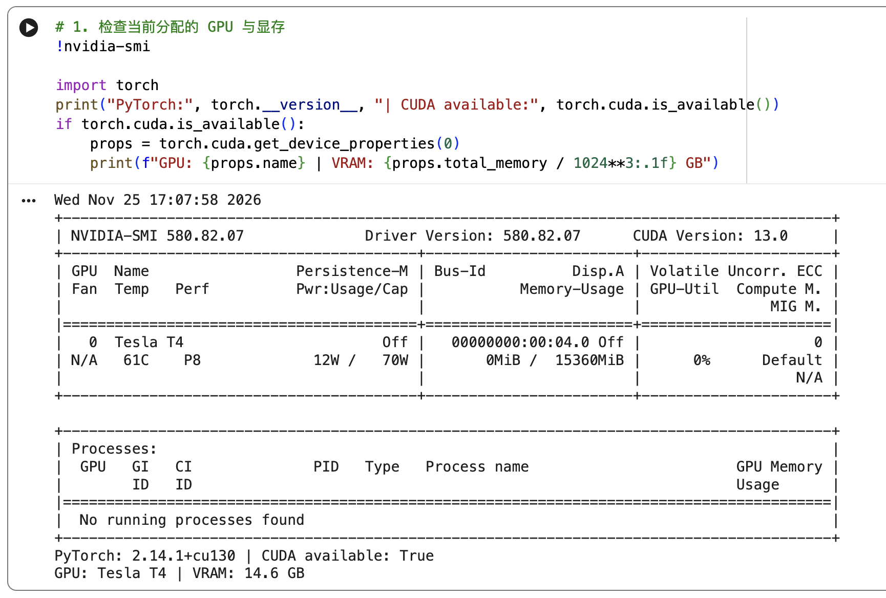
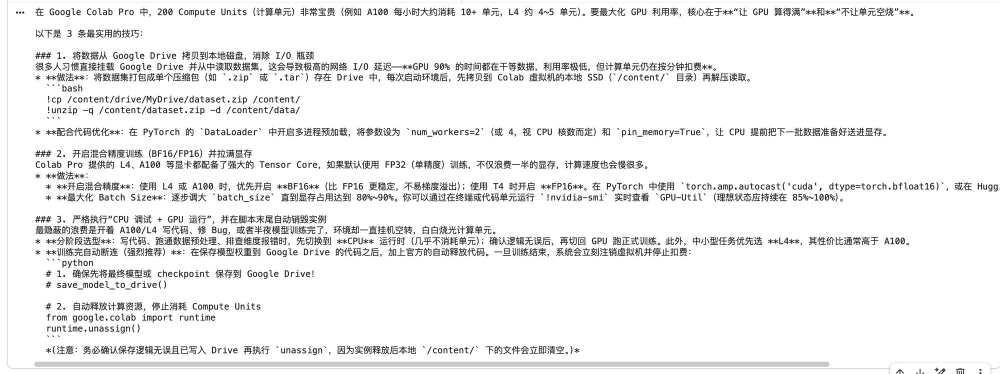

# Google AI Pro Demos 实测报告（2026-11-25）

本报告记录了使用 `google-genai == 3.6.1`（Interactions API）对全部 7 个 Python Demo 的真实端到端测试结果，以及测试过程中发现的 API 版本注意事项。所有生成的文本、图片、音频、视频与深度研究报告均已保存在 `outputs/python/`。

---

## 一、测试环境与关键发现

- **SDK 版本**：`google-genai 3.6.1`、`pydantic 2.14.4`、`python-dotenv 1.2.4`（Python 3.11.5 via `uv`）
- **凭证来源**：本次测试使用环境变量或 `~/.env` 中的 `GEMINI_API_KEY`（`demos/common.py` 会按 `env > 项目 .env > ~/.env` 优先级自动加载）。
- **重要实测发现（已修复并回写代码）**：
  - `google-genai >= 3.0.0` 默认走稳定版 `v1` 端点。
  - `gemini-4-neon`、`gemini-4-hydrogen`、`gemini-nano-banana-2.1` 在默认 `v1` 下直接可用。
  - **`gemini-3.8-flash-tts`、`lyria-3.5`、`gemini-omni-1.2-flash`** 在 `v1` 下会返回 `404 Model not found`，必须显式指定 `api_version="v1beta"`（已同步更新到 `demos/04_tts_and_music.py` 和 `demos/05_video_omni_flash.py`）。
  - `gemini-decision-1`（Decisions API）、`deep-research-preview-04-2026`、`antigravity-preview-09-2026` 均按规范使用 `v1beta`，全部一次通过。

---

## 二、7 项 Python SDK 能力实测总表

> 注：下表中的 `*.txt` 为运行演示脚本时通过 `tee` 重定向保存的终端日志，脚本默认直接输出到终端；图片、音频、视频与 Markdown 报告由脚本直接写入 `outputs/python/`。

| # | Demo 脚本 | 测试模型 / Agent | API 版本 | 状态 | 生成产物 / 输出 |
|---|---|---|---|---|---|
| 01 | `demos/01_text_chat_streaming.py` | `gemini-4-neon`（流式）+ `gemini-4-hydrogen`（多轮） | `v1` | **PASS** | 终端输出（另存 `01_text_chat_streaming.txt`, 5.4 KB） |
| 02 | `demos/02_structured_and_decisions.py` | `gemini-4-hydrogen`（Pydantic JSON）+ `gemini-decision-1` | `v1` / `v1beta` | **PASS** | 终端输出（另存 `02_structured_and_decisions.txt`, 2.1 KB） |
| 03 | `demos/03_image_generation.py` | `gemini-nano-banana-2.1`（2K 16:9 生图 + 多轮修图） | `v1` | **PASS** | `workstation_v1.jpg` (2.4 MB)、`workstation_v2_sunset.jpg` (2.7 MB) |
| 04 | `demos/04_tts_and_music.py` | `gemini-3.8-flash-tts` + `lyria-3.5` | `v1beta` | **PASS** | `welcome_tts.wav` (426 KB)、`demo_synthwave.mp3` (3.9 MB) |
| 05 | `demos/05_video_omni_flash.py` | `gemini-omni-1.2-flash`（1080p 16:9 异步视频+原生音效） | `v1beta` | **PASS** | `coastal_sunrise.mp4` (7.7 MB) |
| 06 | `demos/06_deep_research_agent.py` | `deep-research-preview-04-2026`（后台深度调研） | `v1beta` | **PASS** | `deep_research_report.md` (17 KB) |
| 07 | `demos/07_managed_agent_sandbox.py` | `antigravity-preview-09-2026` (`gemini-4-neon` + 挂载 `gemini-skills`) | `v1beta` | **PASS** | 终端输出（另存 `07_managed_agent_sandbox.txt`, 3.3 KB） |

---

## 三、关键测试输出摘要

### Demo 01：流式生成与服务端多轮状态
- `gemini-4-neon` 流式输出完成（`Total Tokens: 1403`）。
- `gemini-4-hydrogen` 通过 `previous_interaction_id` 成功记住 Turn 1 提到的项目代号 `Project Nova`，并在 Turn 2 给出了针对 Colab 200 CU 的 3 条省算力策略。

### Demo 02：Pydantic 结构化输出 + Decisions API
- `gemini-4-hydrogen` 严格按 `ProPlanSummary` JSON Schema 输出 3 项开发者权益的结构化分析并通过 Pydantic 校验。
- `gemini-decision-1`（0 output tokens 校准判断）针对“YouTube Premium Lite 家庭共享”给出校准概率：
  - `is_allowed`: `P(yes)=0.327, confidence=0.673`（判定不允许）
  - `needs_warning`: `P(yes)=0.834, confidence=0.834`（判定需要提醒）

### Demo 03：Nano Banana 2.1 文生图与对话式修图
- 原图：`outputs/python/workstation_v1.jpg`（2.4 MB，2K 16:9）
- 多轮修图（仅传 `previous_interaction_id` 改为赛博朋克日落灯光并添加咖啡杯）：`outputs/python/workstation_v2_sunset.jpg`（2.7 MB）

### Demo 04：Gemini 3.8 TTS + Lyria 3.5 音乐
- 语音合成：`outputs/python/welcome_tts.wav`（426 KB，`audio/wav`）
- 音乐生成：`outputs/python/demo_synthwave.mp3`（3.9 MB，`audio/mpeg`）

### Demo 05：Gemini Omni 1.2 Flash 异步视频生成
- 轮询 6 次（约 60 秒）后状态变为 `completed`，成功生成带原生海浪/海风环境音的 1080p 16:9 视频：`outputs/python/coastal_sunrise.mp4`（7.7 MB）。

### Demo 06：Deep Research 后台深度调研
- 约 5 分钟完成全网多源调研，产出 17 KB 带引用来源的中文深度对比报告（Google Cloud Run vs Cloudflare Workers）：`outputs/python/deep_research_report.md`。

### Demo 07：Antigravity 远程 Linux 沙盒 + 挂载 `google-gemini/gemini-skills`
- 成功创建远程沙盒（`Environment ID: <ENV_ID>`），自动拉取并识别 `google-gemini/gemini-skills` 仓库内 4 个技能（`gemini-api-dev`、`gemini-api-cli`、`gemini-live-api-dev`、`gemini-omni-flash-api`）。
- 在云端沙盒中自主编写并运行 `benchmark_sort.py`（Python 3.12.3，50,000 随机浮点数），输出 Timsort vs `heapq.nsmallest` 在 Top-10 到 Top-50,000 的完整基准测试表。

---

## 四、Colab GPU 实测与 CLI 状态说明

- **`demos/08_colab_gpu_starter.ipynb`（2026-11-26 实测 PASS）**：
  - 已通过 `rclone` 上传至 `gdrive:Colab Notebooks/08_colab_gpu_starter.ipynb` 并在 Google Colab Web 端验证通过。
  - 确认账号为 **Colab Pro**，**`Available: 200 compute units`** 生效。
  - 实测分配到 **Tesla T4（14.6 GB VRAM，Driver 580.82.07，CUDA 13.0，PyTorch 2.14.1+cu130）**，CUDA 可用；Cell 4 通过 Colab Secrets 调用 `gemini-4-neon` 也一次执行成功。
  - *实测截图*：
    - 
    - 
  - *Colab 预装包小提示*：安装 `google-genai>=3.5.0` 时，pip 会提示 Colab 预装的 `google-colab 1.0.0`（锁 `google-auth==2.49.0`）与 `google-adk 2.7.1`（锁 `google-genai<3`）版本冲突警告，不影响 `google-genai 3.6.1` 正常调用，忽略即可。
- **`scripts/cli_demos/*.sh`**：已完成全部 4 个脚本的 `--dry-run` 与 `bash -n` 语法校验。
